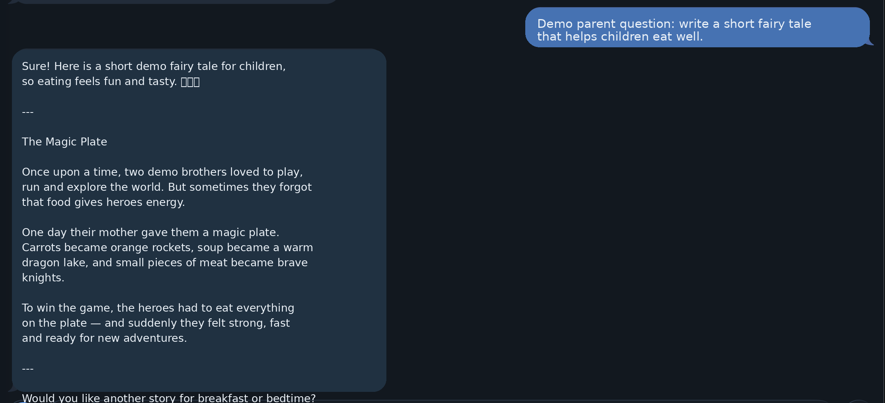
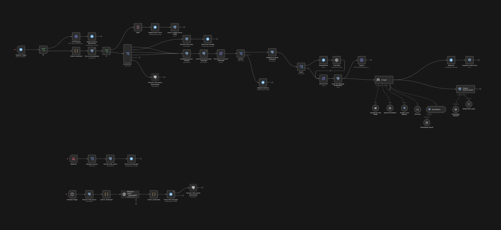
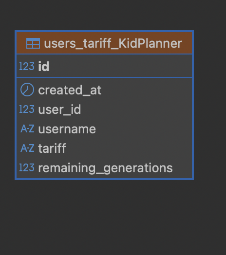
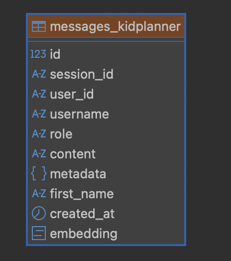
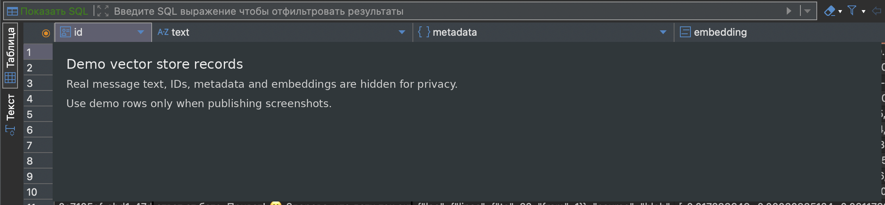

# 🤖 KidPlanner AI Parent Assistant

AI-powered Telegram assistant for parents with PostgreSQL memory, n8n automation, request limits, daily tips, and payment flow.

## 🇬🇧 Short Description

**KidPlanner** is an AI Telegram assistant for parents.

The bot helps parents get quick advice, daily parenting tips, and child-related planning support directly in Telegram. The system stores user context in PostgreSQL, tracks request limits, and can be connected to a payment flow for paid extra requests.

The project is designed as a portfolio-ready automation template built with **Telegram Bot API, n8n, PostgreSQL, OpenAI API, and payment webhooks**.

---

## 🇷🇺 Краткое описание

**KidPlanner** — это AI-помощник для родителей в Telegram.

Бот отвечает на вопросы родителей, даёт ежедневные советы, хранит историю обращений в PostgreSQL, учитывает лимиты запросов и может быть подключён к оплате дополнительных запросов.

Проект подготовлен как портфолио-шаблон автоматизации на базе **Telegram Bot API, n8n, PostgreSQL, OpenAI API и payment webhooks**.

---

## 🖼️ Demo Screenshots

### Telegram AI assistant



### Daily parenting tip


### n8n workflow overview



### PostgreSQL users and tariffs



### PostgreSQL message history



### Vector store records



More details: [`docs/demo-screenshots.md`](docs/demo-screenshots.md)

---

## ✨ Features

- Telegram bot interface
- AI answers for parenting questions
- PostgreSQL user memory and message history
- Request limits per user / tariff
- Daily parenting tips
- Payment flow for extra requests
- n8n automation workflow
- Safe demo configuration without real secrets

---

## 🧩 Architecture

```text
Parent in Telegram
        ↓
Telegram Bot
        ↓
n8n Telegram Trigger
        ↓
PostgreSQL user / limit check
        ↓
OpenAI API request
        ↓
Save dialog history
        ↓
Reply to parent
```

```text
Payment Provider Webhook
        ↓
n8n Webhook
        ↓
Validate payment event
        ↓
Update user limits in PostgreSQL
        ↓
Notify user in Telegram
```

More details: [`docs/architecture.md`](docs/architecture.md)

---

## 🛠️ Tech Stack

- Telegram Bot API
- n8n
- PostgreSQL
- OpenAI API
- Payment webhook integration
- Docker-ready environment variables

---

## 📁 Repository Structure

```text
kidplanner-ai-parent-assistant/
├── README.md
├── LICENSE
├── .gitignore
├── .env.example
├── docs/
│   ├── architecture.md
│   ├── setup-checklist.md
│   ├── security.md
│   ├── demo-screenshots.md
│   └── screenshots/
│       ├── 02-ai-parent-question.png
│       ├── 07-n8n-workflow.png
│       ├── 08-postgresql-users.png
│       ├── 09-postgresql-history.png
│       ├── 10-daily-tip.png
│       └── 11-vector-store-records.png
├── sql/
│   ├── 001_schema.sql
│   ├── 002_demo_data.sql
│   └── 003_queries.md
├── n8n/
│   ├── workflow-notes.md
│   └── workflow-placeholder.json
└── bot/
    └── telegram-message-examples.md
```

---

## ⚙️ Setup Outline

1. Create a Telegram bot.
2. Create PostgreSQL database.
3. Run SQL schema.
4. Configure n8n credentials locally.
5. Connect Telegram Trigger to n8n.
6. Connect OpenAI API credentials.
7. Configure request limit logic.
8. Configure payment webhook.
9. Test free request flow.
10. Test paid extra request flow.
11. Test daily tips workflow.

---

## 🔐 Security Notes

Never commit:

- Telegram bot token
- OpenAI API key
- payment provider secret keys
- real user IDs
- real chat IDs
- real parent messages
- real child names
- real payment data
- PostgreSQL credentials
- n8n credentials
- webhook URLs with production identifiers

Use `.env.example` with placeholders only.

See: [`docs/security.md`](docs/security.md)

---

## 📌 Project Tagline

**English:**  
AI Telegram assistant for parents with PostgreSQL memory, n8n automation, request limits and payment flow.

**Russian:**  
AI Telegram-помощник для родителей с памятью в PostgreSQL, автоматизацией n8n, лимитами запросов и оплатой.

## Maintenance checklist

The items below describe checks to perform, not completed test results. Record the synthetic fixture, observed result, and tested commit when verifying an item; do not use real family or payment data as public evidence.

Maintenance note: verify a successful payment grants the entitlement exactly once and to the matching user account.

Maintenance note: verify failed or refunded payments never increase the user's request allowance.

Maintenance note: confirm demo conversations contain no real child names or family details before publishing screenshots.

Maintenance note: verify replayed payment webhooks remain idempotent after a workflow restart.

Maintenance note: confirm demo message history is periodically reset so portfolio data never drifts into real-user retention.

Maintenance note: confirm example AI responses avoid presenting medical or diagnostic guidance as professional advice.

Maintenance note: verify demo database cleanup removes expired synthetic conversations without affecting schema examples.

Maintenance note: keep demo payment events clearly separated from production webhook examples and transaction records.

Maintenance note: review demo retention examples after schema changes so cleanup rules still match the documented data model.

Maintenance note: reset demo user limits and synthetic message history before recording portfolio screenshots, then verify the request allowance matches the documented baseline before a new walkthrough.

Maintenance note: verify the daily-tip workflow excludes inactive demo users before sending scheduled portfolio examples.

Maintenance note: confirm portfolio notification screenshots contain only synthetic chat names, IDs, and message content.

Maintenance note: verify empty or failed AI responses fall back to a safe user-facing message without consuming an extra paid request.

Maintenance note: confirm demo payment examples use an explicit synthetic currency and amount so they cannot be mistaken for real transactions.

Maintenance note: replay the same synthetic payment event after a demo reset and confirm entitlement state remains idempotent.

Maintenance note: verify demo cleanup preserves request-limit and payment-state consistency before recording portfolio screenshots.

Maintenance note: confirm demo prompts and screenshots avoid implying consent to store real family data beyond the documented synthetic test scope.

Maintenance note: clear synthetic payment references before each new demo run so portfolio examples cannot inherit stale transaction state.

Maintenance note: confirm daily-tip and AI-response demo flows use only the same synthetic user state and never reference production identities.

Maintenance note: after a synthetic payment demo, verify the displayed request allowance matches the stored entitlement state before capturing screenshots.

Maintenance note: verify a read-only demo preview cannot create payment, quota, or conversation records when optional profile data is absent.

Maintenance note: verify read-only previews leave activity, audit, access, and freshness timestamps unchanged.

Maintenance note: verify read-only previews also leave rate-limit counters and cache state untouched so repeated portfolio checks remain side-effect free.

Maintenance note: run portfolio previews in a database read-only transaction; check quota, history, and queued jobs remain unchanged after success and failure.

Maintenance note: verify a preview timeout rolls back cleanly and leaves no partial quota or history update.

Maintenance note: verify a timed-out preview leaves quota, history, and queued work unchanged before retrying.

Maintenance note: verify a preview timeout emits no deferred notification and leaves the user history unchanged.

Maintenance note: verify read-only preview checks leave request limits and rate-limit counters unchanged.

Maintenance note: verify a failed preview leaves cache state and quota unchanged before a retry.

Maintenance note: verify preview-only requests never update `last_sent_at` or schedule a daily-tip delivery.

Maintenance note: verify a rejected payment webhook cannot change quota, tariff, history, or preview state.

Maintenance note: verify the daily-tip scheduler skips missing or invalid chat IDs without consuming quota or retrying indefinitely.

Maintenance note: verify a permanent Telegram delivery error marks the destination unavailable without consuming user quota or retrying indefinitely.

Maintenance note: verify replaying the same payment event updates quota at most once and returns a consistent acknowledgement.

Maintenance note: document the source of truth for purchased request balances and the reconciliation step used after webhook retries.

Maintenance note: document how concurrent daily-tip delivery and manual requests affect quota accounting and message ordering.

Maintenance note: verify daily request limits reset using the documented user-timezone rule rather than the server timezone.

Maintenance note: document the daily-tip opt-out flow and verify scheduled tips never consume the user's request quota.

Maintenance note: document retention and redaction rules for conversation-history examples used in portfolio demonstrations.

Maintenance note: verify a failed AI-provider request does not consume quota and returns a clear retry-safe response.

Maintenance note: document the fallback when voice transcription is unavailable and verify failed transcription does not consume quota.

Maintenance note: document timeout handling for AI responses so retries preserve conversation order without double-charging quota.

- Document the scope of context clearing: distinguish active AI context from persisted conversation history, specify which is cleared, and verify quotas remain unchanged with a synthetic account. Do not present context clearing as account deletion.

- Document the user-facing behavior when voice transcription succeeds but the downstream assistant response times out; use synthetic confirmed transcription and ambiguous timeout cases to specify the retry prompt, transcript retention boundary, and single quota outcome without displaying or logging family content.

- Document how repeated payment callbacks are handled so purchased request credits are applied exactly once; replay synthetic identical, delayed, and conflicting callbacks under one provider transaction identifier, specifying the final credit balance, idempotency record, and redacted alert for inconsistent amounts without real payment data.

- Document how daily advice scheduling behaves when a user changes timezone close to the scheduled send time; use synthetic changes just before and after queueing to define the effective cutoff, local-date ownership, and deliver, reschedule, or skip decision without producing duplicate guidance.

- Document the fallback shown to users when payment confirmation is delayed but the original payment request is still pending; use synthetic pending, confirmed-late, expired, and unknown provider states to define the user message, refresh path, and prohibition on creating a second charge or crediting quota before verified confirmation.

- Document how quota counters are reconciled if an assistant request finishes after the client has disconnected; use synthetic accepted requests that complete before and after disconnect plus a retry with the same idempotency key, and specify one final quota outcome without retaining family content in diagnostics.

- Document the user-visible status shown when a scheduled tip is generated successfully but delivery is deferred; use synthetic transient outage, quiet-hours, and retry-limit cases to define pending, rescheduled, skipped, and failed states while preserving one tip identity and avoiding repeated user notifications.

- Document context-history trimming with a synthetic conversation just beyond the configured limit; specify which complete message exchanges remain, preserve the latest request, and distinguish excluded model context from records actually deleted from storage.

- Document how concurrent messages from the same user are ordered to keep conversation context predictable; use two synthetic messages whose responses finish in reverse order to specify the ordering rule and verify each reply stays paired with its original request without overwriting newer context.

- Document how the assistant handles unsupported voice-message formats without consuming a request credit; use synthetic unsupported and unreadable attachments to specify a text-resubmission prompt, unchanged quota, and no downstream AI request or retained raw audio in diagnostic logs.

- Document expired payment-session recovery using a synthetic purchase: show expiry, preserve the selected option for review, and revalidate the current amount and currency before explicit confirmation of a new session; do not retry charges or grant credits merely because checkout is reopened.

- Document how refunded or reversed payments adjust purchased request credits without producing a negative balance; use synthetic full, partial, duplicate, and late reversals to define idempotent credit adjustment, a zero-balance floor, and a redacted reconciliation alert when already-used credits exceed the reversible amount.

- Document how delivery resumes safely after a user unblocks the bot without sending missed daily tips in a burst.

- Document the account-deletion workflow for conversation history, scheduled tips, and non-sensitive quota records.

- Document how account deletion requests interact with pending payment callbacks and purchased-credit reconciliation.

- Document how payment records required for reconciliation remain separated from deleted conversation and profile data.

- Document safe defaults and user-visible recovery when stored scheduling or preference values are malformed; use synthetic invalid schedule and opt-in values to define a paused daily-tip outcome and a correction prompt, ensuring an unreadable preference is never interpreted as consent and recovery does not change payment or quota state.

- Document how language changes affect queued daily tips without altering quotas or conversation history; use a synthetic queued tip and language update to define send-time language selection, preserve the delivery key, and verify that preference changes neither consume extra quota nor rewrite saved history.

- Document how invalid or obsolete timezone identifiers are detected and corrected without duplicating scheduled tips; use synthetic invalid and deprecated identifiers to define validation, user confirmation of a replacement, and preservation of the already-delivered date marker during rescheduling.

- Document validation for payment amount and currency mismatches before purchased credits are applied; use synthetic matching, wrong-amount, and wrong-currency events to define comparison with the stored purchase, quarantine mismatches, and verify rejected or replayed events never add credits.

- Document how a daily-tip preference update is resolved when it races with scheduler selection for the same user; use a synthetic job selected before notifications are disabled to specify final preference revalidation and cancellation before send without replaying the cancelled tip on restart.

- Document how notification and consent preferences remain associated with an account after the Telegram username changes; use synthetic renamed and reused usernames to verify stable account-identifier matching preserves preferences without transferring consent or history to another account.

- Document the safe user prompt used when detected voice-message language differs from the saved conversation language; use synthetic mismatched and uncertain detections to specify a language confirmation prompt without echoing the transcript or changing the saved preference before confirmation.

- Document how conversation-history retention changes preserve consent settings and avoid exposing archived family data; use synthetic active and expired history markers to define cleanup eligibility, confirm consent settings remain unchanged, and verify expired context is excluded from later guidance.

- Document the user-visible boundary for age-sensitive parenting guidance and the fallback to general educational information; use synthetic missing, invalid, and out-of-scope age inputs to specify clarification or a general fallback without inventing an age or presenting educational output as individualized professional advice.

- Document redaction of payment references and receipt metadata from user-facing support diagnostics; use synthetic receipts to define allowed status fields and mask transaction identifiers, payer details, and attachment URLs, checking nested error messages as well as the main diagnostic text.

- Document quota-reset boundaries when a family changes its saved timezone near the daily reset time; use synthetic accounts moving east and west across midnight to define the authoritative reset instant and verify a timezone edit cannot grant a second daily allowance.

- Document account-deletion propagation across conversation history, support caches, and scheduled-message queues; use a synthetic account marker to define per-store completion checks, cancellation of queued guidance, and retry behavior for partial failures without reporting deletion complete prematurely.

- Document recovery of linked parent preferences after a restart interrupts an in-progress profile update; use a synthetic interrupted save to specify all-or-nothing preference recovery, preserve the last confirmed values, and verify linked caregivers never see a partially applied update.

- Document how scheduled guidance is suppressed while an account export or deletion request is in progress; use synthetic pending, completed, and failed requests to define pause and resume decisions separately for export and deletion, without replaying missed guidance automatically.

- Document idempotent handling of out-of-order payment status webhooks so request balances remain consistent; replay synthetic duplicate and delayed events to specify accepted state transitions, prevent stale events from reversing newer state, and verify each balance adjustment occurs once.

- Document locale fallback for scheduled guidance when a family profile contains an unsupported language code; use a synthetic unsupported locale to identify the configured fallback, verify delivery language, and confirm the stored preference is not silently rewritten.

- Document conflict resolution when multiple linked caregivers update the same child preferences concurrently; use synthetic simultaneous edits to specify version checks, retry behavior, and the final visible result without retaining family details in diagnostic logs.

- Document age-based guidance recalculation after a child's birthday so scheduled advice uses the current age range; use a synthetic profile crossing an age-band boundary to specify timezone, recalculation point, and one-time schedule update without duplicate guidance.

- Document how archived child profiles are excluded from scheduled guidance without deleting retained account history; use one active and one archived synthetic profile to verify recipient selection and that archiving leaves retained history unchanged.

- Document immediate suspension of generated and scheduled guidance after a caregiver revokes processing consent; use a synthetic account with queued advice to verify a final consent check suppresses unsent messages without logging family context.

- Document strict profile isolation when a caregiver manages guidance and history for multiple children; use two synthetic profiles with distinct history markers to verify switching profiles does not reuse the other child's conversation context.

- Document how scheduled guidance pauses for inactive family accounts and resumes without duplicate delivery; use a synthetic account to specify inactive, reactivated, and already-delivered cases, including whether missed guidance is skipped or rescheduled.

- Document the fallback flow for low-confidence voice transcription before parenting guidance is generated; use synthetic input to specify the clarification prompt and verify that an unconfirmed transcript is not saved as confirmed family context.

- Document how notification preferences are merged when a caregiver relinks an existing family account from a new Telegram profile; use an authorized synthetic relink to define preference precedence, preserve opt-out and quiet hours, and verify the old profile receives no further scheduled guidance.

- Document guardian notification behavior when scheduled advice is generated after the daily usage limit has been reached; cover synthetic accounts just below, at, and above the limit, recording the expected delivery and quota result without family data.

- Document scheduled-guidance and quiet-hour behavior across daylight-saving offset changes; use a named test timezone with synthetic skipped and repeated local times to define one authoritative execution instant, preserve the local delivery-day key, and verify no duplicate advice is sent.

- Document expiry and single-use rules for invitations that link an additional caregiver to a family account; use synthetic valid, expired, replayed, and revoked invitation tokens to specify authorization outcomes without exposing token values or family details in logs.

- Document authorization and confirmation when a child profile shared by multiple caregivers is archived or deleted; use synthetic owner, linked-caregiver, revoked-access, and concurrent-request cases to define who may act, which schedules stop, and how retained history is protected without logging family details.

- Document how missing, partial, or approximate birth-date information maps to age-sensitive guidance; use synthetic exact-date, month-only, age-band, and unknown cases to define the least-specific safe output, avoid inventing precision, and keep raw dates out of operational diagnostics.

- Document user-visible recovery when the AI provider is unavailable after a request is accepted; use synthetic timeout, rate-limit, and malformed-response cases to define bounded retry, quota treatment, and a neutral fallback message without saving partial guidance as confirmed conversation context.

- Document handling of instruction-like text embedded in user-provided family context; use synthetic prompts that request hidden configuration or policy overrides to specify that quoted content remains untrusted data, sensitive instructions are never exposed, and guidance stays within the documented parenting scope.

- Document point-in-time consistency when a caregiver requests an account export while family profiles are being edited; use synthetic concurrent create, update, and delete operations to define one export snapshot boundary, avoid mixed-version records, and keep the archive access-controlled and time-limited.

- Document authorization revalidation when a caregiver role is revoked while an AI response is being generated; use synthetic in-flight completion, timeout, and retry cases to suppress delivery after revocation, avoid saving unauthorized output to shared history, and provide a neutral status to the requester.

- Document conflict handling when two authorized caregivers edit the same routine concurrently; use synthetic stale, matching, and sequential versions to preserve the last confirmed schedule, show a reviewable conflict instead of overwriting silently, and avoid sending reminders from an unconfirmed merge.

- Document recurrence behavior for routines anchored on February 29; use synthetic leap-year, non-leap-year, timezone-change, and caregiver-edit cases to define the fallback date explicitly, preserve one confirmed schedule, and avoid duplicate reminders around month boundaries.

- Document how timezone-database rule updates affect already scheduled family reminders; use synthetic unchanged, shifted, removed, and newly introduced offsets to recompute future occurrences from the stored local intent, preserve delivered history, and avoid replaying or silently skipping a reminder.

- Document reminder behavior when device notification permission or a push token is revoked; use synthetic authorized, denied, expired-token, and restored states to record a non-sensitive delivery status, avoid retry storms, preserve the routine, and resume only future reminders after reauthorization.

- Document behavior when a caregiver device clock differs materially from server time; use synthetic fast, slow, corrected, and unavailable client timestamps to keep reminder scheduling server-authoritative, label user-entered local times clearly, and avoid duplicate or retroactive actions after the clock is fixed.

- Document deduplication when the same push token is registered to multiple caregiver devices or accounts; use synthetic unique, repeated-same-owner, conflicting-owner, rotated, and expired tokens to prevent cross-household delivery, preserve current device consent, and require re-registration on ownership conflict.

- Document reconciliation of offline caregiver changes after household access is revoked; use synthetic queued edits created before revocation and synchronized afterward to revalidate authorization per mutation, reject stale writes without exposing current family data, preserve the last confirmed routine, and avoid scheduling reminders from rejected changes.

- Document privacy-safe local-cache cleanup when a caregiver signs out or removes a device; use synthetic shared-device, offline, interrupted-cleanup, and subsequent-user cases to clear family profiles, generated guidance, and notification metadata while preserving only non-sensitive app settings and preventing stale reminders.

- Document reauthorization after an operating-system or cloud backup restores cached app data onto a device; use synthetic same-caregiver, signed-out, revoked-household, and different-user restores to require fresh authorization before showing family content or scheduling notifications, and clear stale local records on mismatch.

- Document authorization checks when a caregiver opens a deep link from an old reminder or guidance notification; use synthetic current-access, revoked-access, switched-household, expired-link, and replayed-link cases to resolve only after fresh authorization, avoid revealing family context in previews, and leave schedules unchanged on rejection.

- Document transfer of family ownership between authorized caregivers; use synthetic accepted, expired, revoked, concurrent, and incomplete transfer cases to require explicit confirmation from both roles, preserve child profiles and schedules atomically, prevent dual ownership, and keep family details out of operational logs.

- Document quota and delivery behavior when a paid entitlement expires while an AI guidance request is in progress; use synthetic expiry before acceptance, during generation, after persistence, and during retry to define one quota decision, prevent duplicate charging, and suppress output only according to the documented authorization boundary.

- Document deletion tombstones for child profiles and routines synchronized from offline devices; use synthetic delete-then-edit, delayed-create, duplicate-delete, expired-device, and authorized-restore cases to prevent stale clients from resurrecting removed family data or schedules without an explicit confirmed recovery flow.

- Document one-time household invitation acceptance for additional caregivers; use synthetic valid, expired, revoked, replayed, wrong-account, and concurrent-acceptance cases to authorize exactly one membership, reveal no child or routine data before acceptance, and leave existing schedules unchanged on rejection.

- Document reminder and data-access reconciliation when a caregiver role is downgraded or household membership is revoked; use synthetic queued, delivered, offline, concurrent-session, and restored-access cases to cancel unauthorized future reminders, invalidate cached access, preserve family schedules, and reveal no child details after revocation.

- Document creation of a caregiver-requested family data export from one consistent authorization snapshot; use synthetic active, revoked-during-export, concurrent-edit, partial-build, and expired-download cases to include only permitted records, prevent mixed-version schedules, remove temporary packages promptly, and reveal no data after access is revoked.

- Document treatment of profile names, routine notes, and imported text as untrusted content during AI guidance generation; use synthetic instruction-like, markup-heavy, multilingual, oversized, and ordinary values to preserve system and safety boundaries, quote context clearly, and keep prompts and family data out of operational logs.

- Document consent renewal when the privacy notice or family-data policy version changes; use synthetic current, superseded, partially accepted, offline, and revoked-account cases to pause new AI processing until the authorized caregiver confirms the new version, preserve existing schedules safely, and avoid exposing family content on the consent screen.

- Document cancellation of an in-progress AI guidance request; use synthetic cancel-before-start, during-generation, after-persistence, repeated-cancel, and provider-timeout cases to stop delivery where possible, apply one documented quota decision, avoid partial guidance, and keep family context out of cancellation logs.

- Document migration of family routines when the household timezone changes; use synthetic eastward, westward, daylight-saving, pending-reminder, and offline-device cases to require explicit caregiver confirmation, preserve intended local times, prevent duplicate or skipped reminders, and retain the prior schedule until migration commits atomically.

- Document notification-token rotation after reinstall, account restore, or operating-system refresh; use synthetic current, replaced, duplicated, revoked, and delayed-registration tokens to bind one authorized device record, retire stale destinations before scheduling, prevent duplicate reminders, and keep token values out of logs and fixtures.

- Document single-occurrence exceptions for recurring family routines; use synthetic skip, move-one, edit-series, overlapping-change, offline-device, and timezone-boundary cases to identify the intended occurrence, preserve unaffected instances, prevent duplicate reminders, and commit the exception atomically across authorized caregivers.

- Document lock-screen notification privacy for family reminders on shared devices; use synthetic generic, child-name, routine-detail, AI-guidance, locked, and unlocked preview cases to default to the least revealing text, honor caregiver-controlled preview settings, and keep sensitive family context out of notification diagnostics.

- Document calendar-locale changes that alter week start, date formatting, or 12/24-hour display without changing stored routine instants; use synthetic Sunday-first, Monday-first, locale switch, offline-device, and concurrent-edit cases to preserve schedule meaning, render consistently per caregiver, and avoid duplicate reminders.

- Document detection and review of potentially duplicate child profiles created by concurrent or offline caregivers; use synthetic exact-name, similar-name, distinct-child, delayed-sync, merged-household, and revoked-access cases to avoid automatic merging, preserve routine ownership, require authorized confirmation, and prevent duplicate reminders.

- Document transfer of the primary-caregiver role within a family household; use synthetic accepted, declined, expired, concurrent-edit, pending-payment, and last-authorized-caregiver cases to require verified consent from both eligible adults, preserve child routines and billing ownership, revoke superseded privileges atomically, and emit no family details in audit logs.

- Document moving a child profile between family households after separation, consolidation, or setup correction; use synthetic accepted, declined, expired, concurrent-routine-edit, pending-reminder, and revoked-caregiver cases to require authorization from eligible caregivers, transfer only selected records atomically, prevent duplicate schedules, and leave unrelated household data inaccessible.

- Document archiving and restoring an inactive child profile without deleting family history; use synthetic no-routine, active-routine, pending-reminder, shared-caregiver, concurrent-edit, and restored-profile cases to pause future guidance atomically, hide archived data from default views, preserve authorized audit history, and prevent duplicate schedules on restoration.

- Document per-child and per-routine reminder muting without disabling the entire family account; use synthetic active, child-muted, routine-muted, expired-mute, concurrent-caregiver, and pending-job cases to compute one authorized final preference, cancel only affected future reminders, preserve unrelated guidance, and avoid replaying missed items when unmuted.

- Document time-limited temporary-caregiver access for travel, childcare, or emergencies; use synthetic accepted, declined, expired, revoked-early, offline-device, and concurrent-edit cases to grant only reviewed child and routine scopes, enforce expiry atomically, cancel future reminders to the temporary caregiver, and keep unrelated household data inaccessible.

- Document caregiver device and session revocation after loss, replacement, or account security review; use synthetic current-device, remote-device, offline, already-revoked, token-refresh, and concurrent-edit cases to invalidate selected access atomically, cancel only that device's future notifications, preserve authorized routine changes, and keep device identifiers out of audit output.

- Document behavior when one caregiver travels and their device timezone changes while the household schedule remains fixed; use synthetic eastward, westward, daylight-saving, offline, concurrent-edit, and return-home cases to display both relevant local context and the authoritative household time clearly, preserve stored routine instants, and prevent duplicate reminders.

- Document caregiver account recovery without bypassing household authorization; use synthetic verified, expired-link, reused-link, changed-contact, revoked-caregiver, last-authorized-caregiver, and concurrent-session cases to restore only the reviewed identity, revoke superseded sessions atomically, preserve family routines, and keep recovery secrets and household details out of diagnostics.

- Document an authorized family-data export for portability and caregiver review; use synthetic single-child, multi-child, archived-profile, revoked-caregiver, concurrent-edit, oversized, and expired-download cases to include only reviewed household scopes, bind one immutable snapshot and schema version, expire access promptly, and exclude secrets, payment tokens, and unrelated families.

- Document deletion of an entire family household with a clear review and retention boundary; use synthetic requested, cancelled, grace-period, expired, shared-caregiver, pending-payment, queued-reminder, and restore-attempt cases to require authorized confirmation, stop future processing atomically, separate mandatory records from erasable family content, and prevent cross-household deletion.

- Document review of long-inactive caregiver access without silently deleting a legitimate family member; use synthetic recently-active, inactive, invited-never-used, temporary, sole-caregiver, pending-transfer, and reauthenticated cases to notify through reviewed channels, require authorized confirmation for revocation, preserve child routines, and keep activity metadata out of family-facing messages.

- Document escalation of an undelivered important routine reminder to another authorized caregiver; use synthetic delivered, transient-failure, permanent-failure, quiet-hours, no-backup-caregiver, already-acknowledged, and duplicate-callback cases to follow explicit household preferences, reveal only the minimum routine context, preserve one reminder identity, and avoid repeated alerts.

- Document verified caregiver consent before creating or expanding a child's stored profile; use synthetic granted, declined, withdrawn, scope-changed, duplicate, conflicting-caregiver, and pending-import cases to collect only reviewed fields, stop future processing when consent is withdrawn, preserve mandatory records separately, and never treat a child's message as adult authorization.

- Document per-caregiver notification language without changing the household's canonical routine data; use synthetic preferred, unsupported, missing, changed, mixed-caregiver, fallback, and duplicate-delivery cases to select one reviewed locale per recipient, preserve stable reminder identity, avoid translating user-entered names, and never infer language from a child's profile.

- Document temporary school-holiday and vacation overrides for recurring routines; use synthetic single-day, date-range, overlapping, shortened-day, cancelled, timezone-crossing, and restored cases to pause or shift only the reviewed occurrences, preserve the underlying routine, notify authorized caregivers consistently, and avoid exposing a child's schedule in diagnostics.

- Document an authorized household home-timezone change after relocation; use synthetic eastward, westward, date-line, daylight-saving, pending-reminder, recurring-routine, and rollback cases to show the proposed schedule before confirmation, preserve original instants where intended, prevent duplicate reminders, and keep location details out of diagnostics.

- Document periodic caregiver access review for households with inactive accounts or devices; use synthetic active, dormant, revoked, role-changed, duplicate-device, unreachable-caregiver, and confirmed-access cases to show authorized adults a minimal review summary, preserve routines while decisions are pending, revoke superseded sessions safely, and expose no child schedule details in notifications or logs.

- Document caregiver offboarding when an adult leaves a household; use synthetic voluntary-exit, administrator-removal, disputed-removal, sole-caregiver, pending-reminder, billing-owner, and rejoin cases to require authorized confirmation, transfer or pause owned routines explicitly, revoke sessions atomically, preserve mandatory records, and expose no child schedule details in notifications or logs.

- Document caregiver-authorized correction of a child's profile fields such as display name, birth date, or timezone; use synthetic valid, unsupported, conflicting-caregiver, age-band-change, pending-reminder, duplicate-request, and rollback cases to show downstream schedule effects before confirmation, preserve historical records separately, prevent duplicate guidance, and keep prior values out of routine logs.

- Document splitting one household into two authorized household records; use synthetic agreed, disputed, sole-caregiver, shared-routine, pending-reminder, billing-owner, and rollback cases to require reviewed caregiver decisions, copy or transfer only explicitly selected routines, prevent duplicate notifications, preserve mandatory history, and keep family relationship details out of diagnostics.

- Document merging two authorized household records after duplicate setup or family reconciliation; use synthetic agreed, disputed, overlapping-child, conflicting-routine, duplicate-reminder, billing-owner, and rollback cases to require reviewed caregiver consent, choose canonical profiles explicitly, preserve mandatory history, prevent duplicated schedules or charges, and keep relationship details out of diagnostics.

- Document read-only grace behavior when a household subscription or entitlement expires; use synthetic active, grace-start, payment-recovered, grace-expired, disputed-charge, offline-device, and duplicate-callback cases to preserve caregiver access to existing routines without generating new paid guidance, pause future billing actions safely, show a clear status, and keep family details out of payment diagnostics.

- Document caregiver access to billing history, invoices, or payment receipts without exposing processor secrets; use synthetic paid, pending, refunded, disputed, duplicate, expired-link, and unauthorized-caregiver cases to show only household-authorized records, use bounded download access, separate payment status from family content, preserve one canonical transaction state, and keep full payment identifiers out of routine logs.

- Document the household transition when a child profile reaches the service's configured adulthood boundary; use synthetic before-boundary, boundary-day, delayed-review, disputed-date, multiple-caregiver, billing-owner, and completed-transition cases to require reviewed consent and access decisions, preserve existing routines during review, revoke superseded caregiver privileges atomically, and expose no family details in audit logs.

- Document that an emergency contact record does not automatically grant household or child-profile access; use synthetic contact-only, invited-caregiver, expired-invite, changed-number, duplicate-contact, unavailable-caregiver, and verified-escalation cases to separate notification from authorization, expose only the minimum reviewed message, preserve existing routines, and keep family details out of diagnostics.

- Document recurring-routine review when a school term or academic year changes; use synthetic same-term, new-term, changed-weekdays, holiday-overlap, child-changed-school, delayed-review, and concurrent-caregiver-edit cases to preserve prior history, apply only approved future occurrences, avoid replaying past reminders, and expose no child or school details in logs.

- Document per-caregiver measurement-unit preferences without changing canonical household data; use synthetic metric, imperial, mixed-caregiver, changed-preference, unsupported-unit, offline-cache, and concurrent-edit cases to convert only presentation values, label units explicitly, preserve stored quantities and routine timing, and keep child details out of conversion diagnostics.

- Document a read-only external-calendar export for approved household routines; use synthetic current, revoked, expired-link, changed-timezone, deleted-routine, duplicate-download, and unauthorized-caregiver cases to include only reviewed future occurrences, preserve canonical routine data, invalidate access promptly, avoid embedding private notes, and keep calendar tokens out of logs.

- Document temporary travel-timezone handling for a child profile without silently changing the household's home timezone; use synthetic departure, arrival, overnight-flight, caregiver-stays-home, recurring-routine, early-return, and overlapping-edit cases to apply only reviewed future reminders, preserve original instants and history, avoid duplicate catch-up sends, and keep location details out of diagnostics.

- Document a caregiver-authorized printable weekly routine summary; use synthetic current, future-change, revoked-caregiver, expired-download, mixed-timezone, missing-routine, and duplicate-request cases to render only reviewed schedule fields, exclude private notes and internal identifiers, preserve canonical routine data, apply bounded access, and keep generated-content details out of routine logs.

- Document reminder acknowledgement when more than one caregiver is authorized for the same routine; use synthetic first-acknowledgement, second-caregiver, simultaneous, snoozed, expired, revoked-caregiver, and offline-device cases to define whether acknowledgement is per-caregiver or household-wide, preserve one routine occurrence, avoid duplicate reminders, and expose no child details in notification metadata.

- Document synchronization when a routine completion is recorded offline by more than one authorized caregiver; use synthetic same-result, conflicting-result, delayed-device, edited-timestamp, revoked-caregiver, deleted-occurrence, and retry cases to apply one reviewed conflict rule, preserve immutable audit history without private notes, avoid duplicate completion side effects or reminders, and expose no child data in sync diagnostics.

- Document household routine exceptions sourced from an approved school or public-holiday calendar; use synthetic ordinary-day, single-holiday, multi-day-break, regional-conflict, timezone-boundary, calendar-revision, and disconnected-source cases to apply only reviewed future exceptions, preserve canonical routines and past history, avoid duplicate reminders, and keep child or school identifiers out of calendar diagnostics.

- Document household behavior when two child profiles have the same display name; use synthetic distinct-IDs, identical-names, renamed-profile, caregiver-limited-access, archived-profile, simultaneous-edit, and reminder-action cases to disambiguate with approved non-sensitive context, bind every routine and completion to stable profile IDs, never merge history by name, and keep child details out of diagnostics.

- Document moving or copying a routine between child profiles; use synthetic explicit-copy, explicit-move, same-name-profiles, completed-history, pending-reminder, unauthorized-caregiver, and concurrent-edit cases to require a reviewed destination ID, keep prior completion history bound to the original profile, regenerate only approved future occurrences, avoid duplicate reminders, and expose no child details in migration diagnostics.

- Document a bounded undo action for an accidentally completed routine occurrence; use synthetic immediate-undo, expired-window, already-reminded, reward-triggered, offline-device, unauthorized-caregiver, and concurrent-update cases to restore only the reviewed occurrence state, preserve immutable audit history without private notes, reverse no external side effect silently, avoid duplicate reminders, and expose no child details in diagnostics.

- Document recording a routine completion retroactively for an earlier date; use synthetic same-day, prior-day, outside-window, timezone-boundary, archived-routine, unauthorized-caregiver, and concurrent-edit cases to require an explicit reviewed occurrence, preserve audit history without private notes, avoid sending past reminders or silently awarding external benefits, and keep child details out of diagnostics.

- Document optional prerequisite relationships between household routines; use synthetic linear-sequence, independent-routines, missing-prerequisite, cyclic-link, skipped-step, archived-routine, unauthorized-edit, and concurrent-completion cases to validate one reviewed acyclic dependency graph, keep each occurrence independently auditable, avoid blocking safety-critical reminders silently, and expose no child details in dependency diagnostics.

- Document versioning of reusable household routine templates; use synthetic unchanged, title-only-change, schedule-change, removed-step, added-step, copied-before-update, archived-template, and concurrent-edit cases to apply revisions only to explicitly selected future instances, preserve existing routine IDs and completion history, avoid silently changing active reminders, and expose no child details in template diagnostics.

- Document an explicit effective date when a caregiver changes a recurring routine schedule; use synthetic immediate, next-occurrence, future-date, timezone-boundary, already-reminded, offline-device, unauthorized-caregiver, and concurrent-edit cases to preserve past occurrences and completion history, regenerate only reviewed future reminders, avoid duplicate or missing notifications, and expose no child details in scheduling diagnostics.

- Document a one-time skip for a single recurring routine occurrence without changing the underlying schedule; use synthetic upcoming, already-reminded, completed, past, timezone-boundary, offline-device, unauthorized-caregiver, and concurrent-edit cases to require an explicit reviewed occurrence, preserve completion history and future cadence, avoid duplicate or catch-up reminders, and expose no child details in skip diagnostics.

- Document temporary delegation of one routine occurrence to another authorized caregiver; use synthetic accepted, declined, expired, already-completed, already-reminded, offline-device, revoked-caregiver, and concurrent-change cases to bind delegation to one explicit occurrence, preserve the recurring routine owner and completion history, avoid duplicate reminders or silent reassignment, and expose no child details in delegation diagnostics.

- Document calculation of optional routine-completion streaks across skipped, paused, and rescheduled occurrences; use synthetic consecutive, missed, one-time-skip, holiday-override, schedule-change, retroactive-completion, timezone-boundary, and concurrent-update cases to derive streaks only from reviewed occurrence states, preserve immutable completion history, avoid turning reminders into punitive scoring, and expose no child details in progress diagnostics.

- Document review of overlapping routines and reminder density before publishing a household schedule; use synthetic independent, same-time, back-to-back, excessive-daily-load, quiet-hours, priority-routine, timezone-change, and concurrent-edit cases to surface conflicts without ranking children or caregivers, require explicit approval for any adjustment, preserve existing completion history, avoid duplicate reminders, and expose no family schedule details in diagnostics.

- Document archiving and restoring an individual household routine without deleting its history; use synthetic no-future-occurrence, pending-reminder, completed-history, delegated-occurrence, archived-template, offline-device, unauthorized-caregiver, and concurrent-edit cases to stop only reviewed future reminders, preserve stable routine and completion IDs, avoid duplicate schedules on restoration, and expose no child details in archive diagnostics.

- Document per-caregiver notification-channel preferences without changing the shared routine schedule; use synthetic Telegram-only, alternate-channel-disabled, all-muted, urgent-reminder, revoked-caregiver, offline-device, pending-notification, and concurrent-preference cases to compute one authorized delivery plan per caregiver, preserve routine and completion history, avoid duplicate cross-channel reminders, and expose no child details in channel diagnostics.

- Document an optional daily household routine digest assembled from already authorized reminder data; use synthetic no-items, one-item, multiple-children, mixed-completion, muted-routine, delegated-occurrence, timezone-boundary, and duplicate-job cases to include each reviewed occurrence once, respect per-caregiver visibility and notification preferences, avoid replacing time-critical reminders silently, and expose no extra child details in digest diagnostics.

- Document batch completion of multiple routine occurrences as one reviewed caregiver action; use synthetic all-pending, mixed-completed, skipped, archived-routine, different-children, offline-device, unauthorized-caregiver, and concurrent-update cases to validate every selected stable occurrence ID before applying changes atomically, preserve individual audit history, avoid duplicate rewards or reminders, and expose no child details in batch diagnostics.

- Document optional routine priority used only for display and reminder ordering; use synthetic equal-priority, high, low, missing, changed-after-reminder, quiet-hours, overlapping-routines, and concurrent-edit cases to require an authorized reviewed value, preserve stable routine and occurrence IDs, avoid changing completion scoring or hiding lower-priority safety reminders, prevent duplicate notifications, and expose no child details in priority diagnostics.

- Document authorized pause and resume behavior for a routine; use synthetic pause-before-reminder, pause-after-reminder, resume-same-day, future-effective, repeated-command, concurrent-edit, expired-routine, and unauthorized-caregiver cases to cancel pending notifications once, preserve routine and occurrence IDs, avoid retroactive completion or score changes, resume from an explicit boundary, and expose no child details in operational diagnostics.

- Document authorized archival and restoration of routines; use synthetic active-with-future-reminders, completed-history, already-archived, restore-same-day, name-conflict, concurrent-edit, expired-plan, and unauthorized-caregiver cases to stop pending notifications once, preserve historical occurrences and stable IDs, avoid retroactive score changes, restore from an explicit effective boundary, and expose no child details in archival diagnostics.

- Document authorized duplication of a routine as a new draft; use synthetic single-step, multi-step, scheduled, archived-source, missing-field, name-conflict, repeated-request, and unauthorized-caregiver cases to copy only reviewed reusable fields, assign new routine and occurrence IDs, leave completion history and scores behind, schedule no reminder until explicit confirmation, and expose no child details in duplication diagnostics.

- Document authorized bulk edits across multiple routines; use synthetic all-valid, one-invalid, mixed-ownership, overlapping-reminders, concurrent-change, repeated-request, partial-timeout, and rollback cases to preview the exact affected set, apply one reviewed atomic policy or report no change, preserve routine and occurrence IDs, recalculate pending reminders without duplicating them, leave completion history and scores unchanged, and expose no child details in diagnostics.

- Document transfer of the primary caregiver role through an explicit reviewed handoff; use synthetic accepted, declined, expired, repeated, concurrent-edit, archived-household, recipient-already-member, and unauthorized-request cases to verify both parties where applicable, preserve child, routine, and occurrence IDs, keep completion history and scores unchanged, revoke superseded privileges promptly, avoid duplicate reminders, and expose no family details in transfer diagnostics.

- Document authorized changes to a routine's reminder channel; use synthetic Telegram-to-email, email-to-push, channel-disabled, unverified-destination, change-after-queueing, quiet-hours, repeated-request, and unauthorized-caregiver cases to verify the new destination before activation, cancel superseded pending notifications once, preserve routine and occurrence IDs, avoid duplicate delivery or score changes, and expose no child or contact details in diagnostics.

- Document caregiver consent withdrawal and related data-handling boundaries; use synthetic immediate, future-effective, repeated, concurrent-reminder, pending-export, shared-household, partial-failure, and unauthorized-request cases to verify authority, stop optional processing and pending outreach once, preserve only records required by an explicit reviewed retention policy, avoid changing historical scores silently, confirm completion without exposing child details, and keep diagnostics free of family content.

- Document bounded retention for uploaded images, voice notes, and other routine attachments; use synthetic unused, referenced, replaced, failed-upload, expired, shared-household, pending-export, and deletion-request cases to classify purpose before storage, keep the shortest reviewed retention period, remove derived copies with the source, preserve routine history without retaining content unnecessarily, prevent duplicate processing, and expose no child, caregiver, or attachment data in diagnostics.

- Document authorized removal of a caregiver from a household; use synthetic pending-reminder, sole-owner, primary-caregiver, repeated-request, concurrent-edit, expired-invite, shared-routine, and unauthorized-request cases to require a reviewed successor when needed, revoke access promptly, cancel only that caregiver's pending notifications, preserve child, routine, occurrence, completion, and score history, avoid duplicate outreach, and expose no family details in removal diagnostics.

- Document reminder delivery failure and optional fallback behavior; use synthetic transient, permanent, blocked-bot, invalid-destination, fallback-available, fallback-unverified, retry-after-success, and quiet-hours cases to classify the failure before retrying, keep one delivery key per occurrence and channel, use only an explicitly authorized fallback, avoid duplicate reminders or score changes, preserve routine and occurrence IDs, and expose no child or contact details in diagnostics.

- Document an explicit reviewed merge for duplicate child profiles; use synthetic exact-duplicate, partial-overlap, conflicting-name, overlapping-routines, shared-caregiver, completed-history, concurrent-edit, and unauthorized-request cases to preview the surviving profile, preserve provenance and stable occurrence IDs, deduplicate pending reminders without changing completion scores, keep ambiguous fields separate for review, support a bounded rollback record, and expose no family details in merge diagnostics.

- Document optional routine groups for organizing related plans without changing completion semantics; use synthetic empty-group, multi-routine, routine-in-two-groups, reordered, archived-routine, deleted-group, concurrent-edit, and unauthorized-caregiver cases to preserve stable routine and occurrence IDs, make grouping changes atomic, keep scores and completion history independent, avoid duplicate reminders, restore ungrouped routines visibly, and expose no child details in diagnostics.

- Document a reviewed profile-split workflow for undoing an accidental child-profile merge; use synthetic separable-history, shared-routine, overlapping-caregiver, ambiguous-event, completed-history, concurrent-edit, interrupted-split, and unauthorized-request cases to preview ownership of each record, preserve stable occurrence IDs and provenance, avoid duplicate reminders or score changes, require manual review for ambiguity, support bounded rollback, and expose no family details in diagnostics.

- Document expiration of temporary caregiver access; use synthetic future-expiry, immediate-expiry, extended, revoked-early, offline-device, pending-reminder, concurrent-edit, and unauthorized-extension cases to stop new access at the authoritative deadline, preserve completed history and stable occurrence IDs, cancel only caregiver-specific pending delivery, avoid duplicate reminders, make renewal explicit, and expose no family details in diagnostics.

- Document a reviewed household-merge workflow for families intentionally combining planning spaces; use synthetic disjoint-children, shared-child, overlapping-caregivers, duplicate-routines, conflicting-timezones, completed-history, concurrent-edit, and unauthorized-request cases to preview the surviving workspace, preserve stable child and occurrence IDs with provenance, deduplicate pending reminders without changing scores, keep ambiguous records separate for review, support bounded rollback, and expose no family details in diagnostics.
