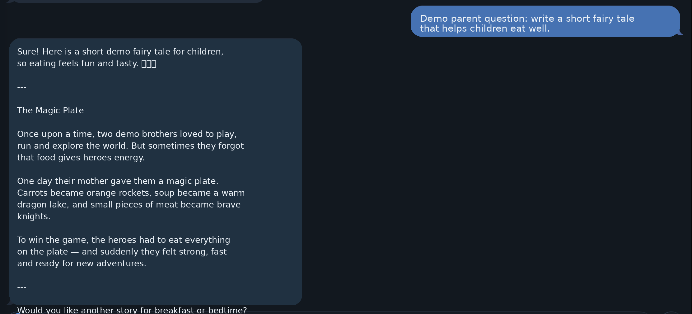
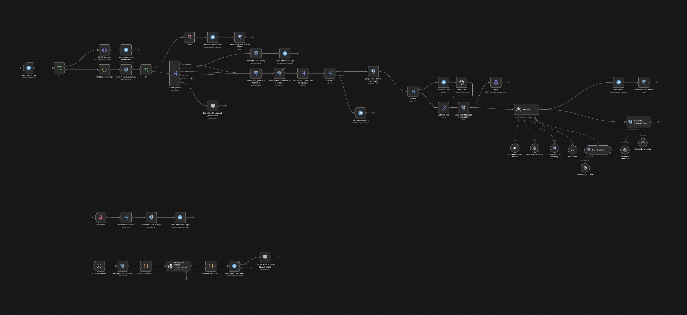
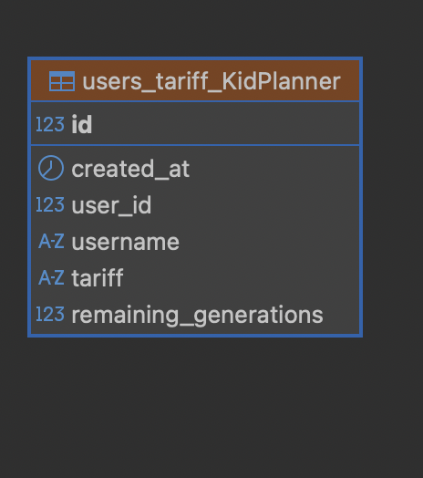
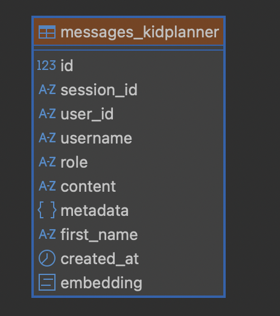
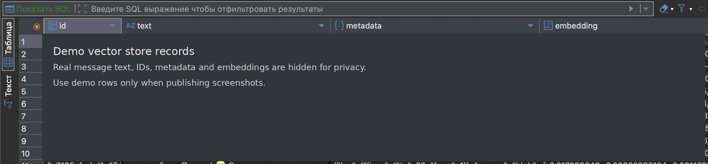

# 🤖 KidPlanner AI Parent Assistant

AI-powered Telegram assistant for parents with PostgreSQL memory, n8n automation, request limits, daily tips, and payment flow.

## 🇬🇧 Short Description

**KidPlanner** is an AI Telegram assistant for parents.

The bot helps parents get quick advice, daily parenting tips, and child-related planning support directly in Telegram. The system stores user context in PostgreSQL, tracks request limits, and can be connected to a payment flow for paid extra requests.

The project is designed as a portfolio-ready automation template built with **Telegram Bot API, n8n, PostgreSQL, OpenAI API, and payment webhooks**.

---

## 🇷🇺 Краткое описание

**KidPlanner** — это AI-помощник для родителей в Telegram.

Бот отвечает на вопросы родителей, даёт ежедневные советы, хранит историю обращений в PostgreSQL, учитывает лимиты запросов и может быть подключён к оплате дополнительных запросов.

Проект подготовлен как портфолио-шаблон автоматизации на базе **Telegram Bot API, n8n, PostgreSQL, OpenAI API и payment webhooks**.

---

## 🖼️ Demo Screenshots

### Telegram AI assistant



### Daily parenting tip


### n8n workflow overview



### PostgreSQL users and tariffs



### PostgreSQL message history



### Vector store records



More details: [`docs/demo-screenshots.md`](docs/demo-screenshots.md)

---

## ✨ Features

- Telegram bot interface
- AI answers for parenting questions
- PostgreSQL user memory and message history
- Request limits per user / tariff
- Daily parenting tips
- Payment flow for extra requests
- n8n automation workflow
- Safe demo configuration without real secrets

---

## 🧩 Architecture

```text
Parent in Telegram
        ↓
Telegram Bot
        ↓
n8n Telegram Trigger
        ↓
PostgreSQL user / limit check
        ↓
OpenAI API request
        ↓
Save dialog history
        ↓
Reply to parent
```

```text
Payment Provider Webhook
        ↓
n8n Webhook
        ↓
Validate payment event
        ↓
Update user limits in PostgreSQL
        ↓
Notify user in Telegram
```

More details: [`docs/architecture.md`](docs/architecture.md)

---

## 🛠️ Tech Stack

- Telegram Bot API
- n8n
- PostgreSQL
- OpenAI API
- Payment webhook integration
- Docker-ready environment variables

---

## 📁 Repository Structure

```text
kidplanner-ai-parent-assistant/
├── README.md
├── LICENSE
├── .gitignore
├── .env.example
├── docs/
│   ├── architecture.md
│   ├── setup-checklist.md
│   ├── security.md
│   ├── demo-screenshots.md
│   └── screenshots/
│       ├── 02-ai-parent-question.png
│       ├── 07-n8n-workflow.png
│       ├── 08-postgresql-users.png
│       ├── 09-postgresql-history.png
│       ├── 10-daily-tip.png
│       └── 11-vector-store-records.png
├── sql/
│   ├── 001_schema.sql
│   ├── 002_demo_data.sql
│   └── 003_queries.md
├── n8n/
│   ├── workflow-notes.md
│   └── workflow-placeholder.json
└── bot/
    └── telegram-message-examples.md
```

---

## ⚙️ Setup Outline

1. Create a Telegram bot.
2. Create PostgreSQL database.
3. Run SQL schema.
4. Configure n8n credentials locally.
5. Connect Telegram Trigger to n8n.
6. Connect OpenAI API credentials.
7. Configure request limit logic.
8. Configure payment webhook.
9. Test free request flow.
10. Test paid extra request flow.
11. Test daily tips workflow.

---

## 🔐 Security Notes

Never commit:

- Telegram bot token
- OpenAI API key
- payment provider secret keys
- real user IDs
- real chat IDs
- real parent messages
- real child names
- real payment data
- PostgreSQL credentials
- n8n credentials
- webhook URLs with production identifiers

Use `.env.example` with placeholders only.

See: [`docs/security.md`](docs/security.md)

---

## 📌 Project Tagline

**English:**  
AI Telegram assistant for parents with PostgreSQL memory, n8n automation, request limits and payment flow.

**Russian:**  
AI Telegram-помощник для родителей с памятью в PostgreSQL, автоматизацией n8n, лимитами запросов и оплатой.

## Maintenance checklist

The items below describe checks to perform, not completed test results. Record the synthetic fixture, observed result, and tested commit when verifying an item; do not use real family or payment data as public evidence.

Maintenance note: verify a successful payment grants the entitlement exactly once and to the matching user account.

Maintenance note: verify failed or refunded payments never increase the user's request allowance.

Maintenance note: confirm demo conversations contain no real child names or family details before publishing screenshots.

Maintenance note: verify replayed payment webhooks remain idempotent after a workflow restart.

Maintenance note: confirm demo message history is periodically reset so portfolio data never drifts into real-user retention.

Maintenance note: confirm example AI responses avoid presenting medical or diagnostic guidance as professional advice.

Maintenance note: verify demo database cleanup removes expired synthetic conversations without affecting schema examples.

Maintenance note: keep demo payment events clearly separated from production webhook examples and transaction records.

Maintenance note: review demo retention examples after schema changes so cleanup rules still match the documented data model.

Maintenance note: reset demo user limits and synthetic message history before recording portfolio screenshots, then verify the request allowance matches the documented baseline before a new walkthrough.

Maintenance note: verify the daily-tip workflow excludes inactive demo users before sending scheduled portfolio examples.

Maintenance note: confirm portfolio notification screenshots contain only synthetic chat names, IDs, and message content.

Maintenance note: verify empty or failed AI responses fall back to a safe user-facing message without consuming an extra paid request.

Maintenance note: confirm demo payment examples use an explicit synthetic currency and amount so they cannot be mistaken for real transactions.

Maintenance note: replay the same synthetic payment event after a demo reset and confirm entitlement state remains idempotent.

Maintenance note: verify demo cleanup preserves request-limit and payment-state consistency before recording portfolio screenshots.

Maintenance note: confirm demo prompts and screenshots avoid implying consent to store real family data beyond the documented synthetic test scope.

Maintenance note: clear synthetic payment references before each new demo run so portfolio examples cannot inherit stale transaction state.

Maintenance note: confirm daily-tip and AI-response demo flows use only the same synthetic user state and never reference production identities.

Maintenance note: after a synthetic payment demo, verify the displayed request allowance matches the stored entitlement state before capturing screenshots.

Maintenance note: verify a read-only demo preview cannot create payment, quota, or conversation records when optional profile data is absent.

Maintenance note: verify read-only previews leave activity, audit, access, and freshness timestamps unchanged.

Maintenance note: verify read-only previews also leave rate-limit counters and cache state untouched so repeated portfolio checks remain side-effect free.

Maintenance note: run portfolio previews in a database read-only transaction; check quota, history, and queued jobs remain unchanged after success and failure.

Maintenance note: verify a preview timeout rolls back cleanly and leaves no partial quota or history update.

Maintenance note: verify a timed-out preview leaves quota, history, and queued work unchanged before retrying.

Maintenance note: verify a preview timeout emits no deferred notification and leaves the user history unchanged.

Maintenance note: verify read-only preview checks leave request limits and rate-limit counters unchanged.

Maintenance note: verify a failed preview leaves cache state and quota unchanged before a retry.

Maintenance note: verify preview-only requests never update `last_sent_at` or schedule a daily-tip delivery.

Maintenance note: verify a rejected payment webhook cannot change quota, tariff, history, or preview state.

Maintenance note: verify the daily-tip scheduler skips missing or invalid chat IDs without consuming quota or retrying indefinitely.

Maintenance note: verify a permanent Telegram delivery error marks the destination unavailable without consuming user quota or retrying indefinitely.

Maintenance note: verify replaying the same payment event updates quota at most once and returns a consistent acknowledgement.

Maintenance note: document the source of truth for purchased request balances and the reconciliation step used after webhook retries.

Maintenance note: document how concurrent daily-tip delivery and manual requests affect quota accounting and message ordering.

Maintenance note: verify daily request limits reset using the documented user-timezone rule rather than the server timezone.

Maintenance note: document the daily-tip opt-out flow and verify scheduled tips never consume the user's request quota.

Maintenance note: document retention and redaction rules for conversation-history examples used in portfolio demonstrations.

Maintenance note: verify a failed AI-provider request does not consume quota and returns a clear retry-safe response.

Maintenance note: document the fallback when voice transcription is unavailable and verify failed transcription does not consume quota.

Maintenance note: document timeout handling for AI responses so retries preserve conversation order without double-charging quota.

- Document the scope of context clearing: distinguish active AI context from persisted conversation history, specify which is cleared, and verify quotas remain unchanged with a synthetic account. Do not present context clearing as account deletion.

- Document the user-facing behavior when voice transcription succeeds but the downstream assistant response times out; use synthetic confirmed transcription and ambiguous timeout cases to specify the retry prompt, transcript retention boundary, and single quota outcome without displaying or logging family content.

- Document how repeated payment callbacks are handled so purchased request credits are applied exactly once; replay synthetic identical, delayed, and conflicting callbacks under one provider transaction identifier, specifying the final credit balance, idempotency record, and redacted alert for inconsistent amounts without real payment data.

- Document how daily advice scheduling behaves when a user changes timezone close to the scheduled send time; use synthetic changes just before and after queueing to define the effective cutoff, local-date ownership, and deliver, reschedule, or skip decision without producing duplicate guidance.

- Document the fallback shown to users when payment confirmation is delayed but the original payment request is still pending; use synthetic pending, confirmed-late, expired, and unknown provider states to define the user message, refresh path, and prohibition on creating a second charge or crediting quota before verified confirmation.

- Document how quota counters are reconciled if an assistant request finishes after the client has disconnected; use synthetic accepted requests that complete before and after disconnect plus a retry with the same idempotency key, and specify one final quota outcome without retaining family content in diagnostics.

- Document the user-visible status shown when a scheduled tip is generated successfully but delivery is deferred; use synthetic transient outage, quiet-hours, and retry-limit cases to define pending, rescheduled, skipped, and failed states while preserving one tip identity and avoiding repeated user notifications.

- Document context-history trimming with a synthetic conversation just beyond the configured limit; specify which complete message exchanges remain, preserve the latest request, and distinguish excluded model context from records actually deleted from storage.

- Document how concurrent messages from the same user are ordered to keep conversation context predictable; use two synthetic messages whose responses finish in reverse order to specify the ordering rule and verify each reply stays paired with its original request without overwriting newer context.

- Document how the assistant handles unsupported voice-message formats without consuming a request credit; use synthetic unsupported and unreadable attachments to specify a text-resubmission prompt, unchanged quota, and no downstream AI request or retained raw audio in diagnostic logs.

- Document expired payment-session recovery using a synthetic purchase: show expiry, preserve the selected option for review, and revalidate the current amount and currency before explicit confirmation of a new session; do not retry charges or grant credits merely because checkout is reopened.

- Document how refunded or reversed payments adjust purchased request credits without producing a negative balance; use synthetic full, partial, duplicate, and late reversals to define idempotent credit adjustment, a zero-balance floor, and a redacted reconciliation alert when already-used credits exceed the reversible amount.

- Document how delivery resumes safely after a user unblocks the bot without sending missed daily tips in a burst.

- Document the account-deletion workflow for conversation history, scheduled tips, and non-sensitive quota records.

- Document how account deletion requests interact with pending payment callbacks and purchased-credit reconciliation.

- Document how payment records required for reconciliation remain separated from deleted conversation and profile data.

- Document safe defaults and user-visible recovery when stored scheduling or preference values are malformed; use synthetic invalid schedule and opt-in values to define a paused daily-tip outcome and a correction prompt, ensuring an unreadable preference is never interpreted as consent and recovery does not change payment or quota state.

- Document how language changes affect queued daily tips without altering quotas or conversation history; use a synthetic queued tip and language update to define send-time language selection, preserve the delivery key, and verify that preference changes neither consume extra quota nor rewrite saved history.

- Document how invalid or obsolete timezone identifiers are detected and corrected without duplicating scheduled tips; use synthetic invalid and deprecated identifiers to define validation, user confirmation of a replacement, and preservation of the already-delivered date marker during rescheduling.

- Document validation for payment amount and currency mismatches before purchased credits are applied; use synthetic matching, wrong-amount, and wrong-currency events to define comparison with the stored purchase, quarantine mismatches, and verify rejected or replayed events never add credits.

- Document how a daily-tip preference update is resolved when it races with scheduler selection for the same user; use a synthetic job selected before notifications are disabled to specify final preference revalidation and cancellation before send without replaying the cancelled tip on restart.

- Document how notification and consent preferences remain associated with an account after the Telegram username changes; use synthetic renamed and reused usernames to verify stable account-identifier matching preserves preferences without transferring consent or history to another account.

- Document the safe user prompt used when detected voice-message language differs from the saved conversation language; use synthetic mismatched and uncertain detections to specify a language confirmation prompt without echoing the transcript or changing the saved preference before confirmation.

- Document how conversation-history retention changes preserve consent settings and avoid exposing archived family data; use synthetic active and expired history markers to define cleanup eligibility, confirm consent settings remain unchanged, and verify expired context is excluded from later guidance.

- Document the user-visible boundary for age-sensitive parenting guidance and the fallback to general educational information; use synthetic missing, invalid, and out-of-scope age inputs to specify clarification or a general fallback without inventing an age or presenting educational output as individualized professional advice.

- Document redaction of payment references and receipt metadata from user-facing support diagnostics; use synthetic receipts to define allowed status fields and mask transaction identifiers, payer details, and attachment URLs, checking nested error messages as well as the main diagnostic text.

- Document quota-reset boundaries when a family changes its saved timezone near the daily reset time; use synthetic accounts moving east and west across midnight to define the authoritative reset instant and verify a timezone edit cannot grant a second daily allowance.

- Document account-deletion propagation across conversation history, support caches, and scheduled-message queues; use a synthetic account marker to define per-store completion checks, cancellation of queued guidance, and retry behavior for partial failures without reporting deletion complete prematurely.

- Document recovery of linked parent preferences after a restart interrupts an in-progress profile update; use a synthetic interrupted save to specify all-or-nothing preference recovery, preserve the last confirmed values, and verify linked caregivers never see a partially applied update.

- Document how scheduled guidance is suppressed while an account export or deletion request is in progress; use synthetic pending, completed, and failed requests to define pause and resume decisions separately for export and deletion, without replaying missed guidance automatically.

- Document idempotent handling of out-of-order payment status webhooks so request balances remain consistent; replay synthetic duplicate and delayed events to specify accepted state transitions, prevent stale events from reversing newer state, and verify each balance adjustment occurs once.

- Document locale fallback for scheduled guidance when a family profile contains an unsupported language code; use a synthetic unsupported locale to identify the configured fallback, verify delivery language, and confirm the stored preference is not silently rewritten.

- Document conflict resolution when multiple linked caregivers update the same child preferences concurrently; use synthetic simultaneous edits to specify version checks, retry behavior, and the final visible result without retaining family details in diagnostic logs.

- Document age-based guidance recalculation after a child's birthday so scheduled advice uses the current age range; use a synthetic profile crossing an age-band boundary to specify timezone, recalculation point, and one-time schedule update without duplicate guidance.

- Document how archived child profiles are excluded from scheduled guidance without deleting retained account history; use one active and one archived synthetic profile to verify recipient selection and that archiving leaves retained history unchanged.

- Document immediate suspension of generated and scheduled guidance after a caregiver revokes processing consent; use a synthetic account with queued advice to verify a final consent check suppresses unsent messages without logging family context.

- Document strict profile isolation when a caregiver manages guidance and history for multiple children; use two synthetic profiles with distinct history markers to verify switching profiles does not reuse the other child's conversation context.

- Document how scheduled guidance pauses for inactive family accounts and resumes without duplicate delivery; use a synthetic account to specify inactive, reactivated, and already-delivered cases, including whether missed guidance is skipped or rescheduled.

- Document the fallback flow for low-confidence voice transcription before parenting guidance is generated; use synthetic input to specify the clarification prompt and verify that an unconfirmed transcript is not saved as confirmed family context.

- Document how notification preferences are merged when a caregiver relinks an existing family account from a new Telegram profile; use an authorized synthetic relink to define preference precedence, preserve opt-out and quiet hours, and verify the old profile receives no further scheduled guidance.

- Document guardian notification behavior when scheduled advice is generated after the daily usage limit has been reached; cover synthetic accounts just below, at, and above the limit, recording the expected delivery and quota result without family data.

- Document scheduled-guidance and quiet-hour behavior across daylight-saving offset changes; use a named test timezone with synthetic skipped and repeated local times to define one authoritative execution instant, preserve the local delivery-day key, and verify no duplicate advice is sent.

- Document expiry and single-use rules for invitations that link an additional caregiver to a family account; use synthetic valid, expired, replayed, and revoked invitation tokens to specify authorization outcomes without exposing token values or family details in logs.

- Document authorization and confirmation when a child profile shared by multiple caregivers is archived or deleted; use synthetic owner, linked-caregiver, revoked-access, and concurrent-request cases to define who may act, which schedules stop, and how retained history is protected without logging family details.

- Document how missing, partial, or approximate birth-date information maps to age-sensitive guidance; use synthetic exact-date, month-only, age-band, and unknown cases to define the least-specific safe output, avoid inventing precision, and keep raw dates out of operational diagnostics.

- Document user-visible recovery when the AI provider is unavailable after a request is accepted; use synthetic timeout, rate-limit, and malformed-response cases to define bounded retry, quota treatment, and a neutral fallback message without saving partial guidance as confirmed conversation context.
